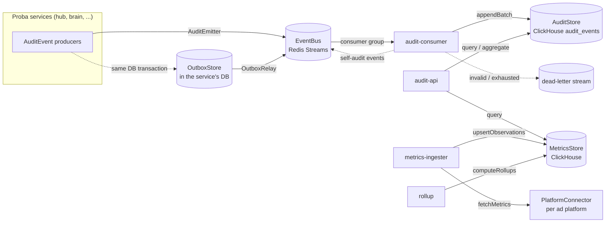

# proba-audit architecture

## Purpose

proba-audit is the audit trail and ad-metrics analytics backend of Proba.

- **Audit:** every Proba service emits an `AuditEvent` for every action or step. proba-audit
  stores them in an append-only, hash-chained log that can be queried by trace, goal, user, time, etc.
- **Metrics:** ad-platform numbers (Meta, Google, Reddit, X, Microsoft, ...) are fetched,
  normalised into `MetricObservation`s, stored with revisions, and rolled up per hour and day.

The event and observation shapes are defined once, in
[proba-protocol](https://github.com/smallseedlabs/proba-protocol) (`@smallseedlabs/proba-protocol/audit`).
This repo never redefines them. (Pinned to the `v0.2.0` release tag.)

This PR is the **foundation only**: ports, default adapters, config, logger, migrations and
runnable-but-empty processes. The consumer, API, ingester and rollup logic come later.

## Processes

| App | Port | Job (later) |
|-----|------|-------------|
| `apps/audit-consumer` | 3101 | Read audit events from the bus, validate, extend the hash chain, append to the AuditStore, ack / dead-letter |
| `apps/audit-api` | 3100 | Query API over the AuditStore and MetricsStore |
| `apps/metrics-ingester` | 3102 | Use PlatformConnectors to fetch ad metrics and upsert `MetricObservation`s |
| `apps/rollup` | 3103 | Recompute hourly/daily rollups from the latest observation revisions |

Each one loads config, logs its lifecycle as structured JSON, serves `GET /health`, and exits 0 on SIGTERM/SIGINT
(all four use `runService` from `packages/core`). `audit-consumer` runs the audit pipeline described below; the other three
are still the foundation skeleton. One Dockerfile has a target per app (plus `migrate`).

## The two flows



**Audit flow:** a producer records an event with an `AuditEmitter` (directly to the bus, or through the outbox) ->
`audit-consumer` reads with a consumer group -> validates -> dedupes -> derives tags -> adds `prevHash`/`hash`/`ingestedAt`/
`schemaVersion` (making a `StoredAuditEvent`) -> `AuditStore.appendBatch` -> `XACK` only after that write.
Details, guarantees and failure modes are in "Audit pipeline" below.

**Metrics flow:** `metrics-ingester` asks a `PlatformConnector` for a window -> `MetricsStore.upsertObservations`
(a higher `revision` replaces a lower one; a stale one is skipped) -> `rollup` calls `computeRollups` for the
touched window -> `audit-api` serves observations and rollups.

## Ports and adapters

Ports are TypeScript interfaces in `packages/core/src/ports`. Adapters live in `packages/adapters`.
The adapter for each port is chosen by an environment variable and created through a registry
(`createDefaultRegistries` / `createRuntime` in `packages/adapters/src/runtime/registries.ts`).

| Port | Default adapter | Other adapters | Config | Contract helper |
|------|-----------------|----------------|--------|-----------------|
| `EventBus` | `RedisStreamsEventBus` (`redis-streams`) | `InMemoryEventBus` (`memory`) | `EVENT_BUS` | `runEventBusContract` |
| `AuditStore` | `ClickHouseAuditStore` (`clickhouse`) | `InMemoryAuditStore` (`memory`) | `AUDIT_STORE` | `runAuditStoreContract` |
| `AuditEmitter` | `createBusAuditEmitter` (publishes to the bus), `createOutboxAuditEmitter` (writes to an outbox) | any `AuditSender` via `createAuditEmitter` | code | unit tests in `audit-pipeline.test.ts` |
| `OutboxStore` | `PostgresOutboxStore` (lives in the emitting service's database) | `InMemoryOutboxStore` | code (the service owns its DB) | `runOutboxStoreContract` |
| `MetricsStore` | `ClickHouseMetricsStore` (`clickhouse`) | `InMemoryMetricsStore` (`memory`) | `METRICS_STORE` | `runMetricsStoreContract` |
| `Clock` | `SystemClock` | `ManualClock` | code (`createRuntime` option) | `runClockContract` |
| `IdGenerator` | `RandomIdGenerator` | `SequentialIdGenerator` | code (`createRuntime` option) | `runIdGeneratorContract` |
| `Logger` | pino JSON logger (`createLogger`) | `MemoryLogger` | `LOG_LEVEL` | `runLoggerContract` |
| `PlatformConnector` | none yet (one per platform, later) | `StaticPlatformConnector` (tests) | per platform, later | `runPlatformConnectorContract` |

### How to swap or add an adapter (for example Kafka)

1. Implement the port, for example `class KafkaEventBus implements EventBus` in `packages/adapters/src/kafka/`.
2. Run the port's contract suite against it:
   ```ts
   import { runEventBusContract } from '@smallseedlabs/proba-audit-core/testing';
   runEventBusContract('kafka', async () => ({ bus: new KafkaEventBus(...) }));
   ```
   (Put it in an `*.integration.test.ts` file if it needs a running service.)
3. Register one factory: `registries.eventBus.register('kafka', (deps) => new KafkaEventBus(...))`
   in `createDefaultRegistries` (or pass your own `registries` to `createRuntime`).
4. Set one config value: `EVENT_BUS=kafka`.

No config schema change is needed: adapter names are plain strings, checked against the registry at startup
(an unknown name fails with the list of available adapters). No app code changes either, because apps only see ports.

### EventBus delivery model

At-least-once, with consumer groups. `read` delivers new messages, which stay *pending* until `ack`. `reclaimPending`
re-delivers messages idle longer than `BUS_CLAIM_IDLE_MS` (each delivery bumps `deliveryCount`) and dead-letters
those that reached `BUS_MAX_DELIVERIES`. `deadLetter` moves a poison message to the dead-letter store at once.
On Redis Streams: `XADD`, `XREADGROUP`, `XACK`, `XPENDING`+`XCLAIM`, and the `<topic>.dlq` stream.
Redis runs with AOF on in `docker-compose.yml` so the stream survives restarts.

## Audit pipeline

### Producing events: `AuditEmitter`, outbox, relay

`AuditEmitter.emit(draft, { tx? })` (`packages/core/src/audit/emitter.ts`) builds the event with the protocol's
`buildAuditEvent` (defaults: `service`, `workspaceId`, `traceId`, `eventId`, `spanId`, `occurredAt`, taken from the emitter,
`IdGenerator` and `Clock`), validates it with the protocol schema (an invalid event throws `AuditValidationError` and is
logged; with `failureMode: 'swallow'` it logs and resolves `null`), then hands it to a transport.
`emitter.forTrace(traceId, parentSpanId)` stamps a trace on everything emitted through it.

Two transports:

- **Bus** (`createBusAuditEmitter`): `EventBus.publish(AUDIT_TOPIC, event, { key: workspaceId })`. Simple, but the event is lost
  if the process dies between the business change and the publish.
- **Outbox** (`createOutboxAuditEmitter` + `OutboxRelay`): the event is inserted into an `audit_outbox` table **in the service's
  own database transaction** (`emit(draft, { tx })`), so it exists if and only if the business change committed. An
  `OutboxRelay` claims rows (`FOR UPDATE SKIP LOCKED` plus a lease, so several relays can run), publishes them to the bus in
  order, then marks them published; a bus failure marks them failed and they are retried after the lease. Publishing is
  at-least-once and the consumer dedupes by `eventId`.

`OutboxStore` is a port. `PostgresOutboxStore` is the adapter meant for the Hub: schema in
`migrations/postgres/0001_audit_outbox.sql` (apply it to the *service's* database, not to ClickHouse), usage:
`await emitter.emit(draft, { tx: pgClientInsideBeginCommit })`. This repo does not change the Hub; wiring it in is a Hub change.

### Consuming events: `apps/audit-consumer`

Per batch (`AuditConsumer.processBatch`):

1. **Validate** every message with the protocol schema. Invalid -> dead-letter with the reason (`invalid audit event: path: message`), error log with the `traceId` if the payload has one. Producer-supplied chain fields are stripped by the schema, never trusted.
2. **Dedupe**, before chaining (a skipped duplicate must never leave a gap in the chain): within the batch and against the store (`AuditStore.findExisting`). Same `eventId` and same content -> skipped silently (counted, acked). Same `eventId` but **different content** -> not written, dead-lettered with a reason naming both content hashes, logged as an error.
3. **Derive tags** (`category:x`, `outcome:x`, `service:x`, `risk:x` when set), appended after the producer's own tags.
4. **Chain** per workspace using the cached head (below).
5. **Write** with `AuditStore.appendBatch`. If it throws, nothing is acknowledged; the batch is retried in place with exponential backoff (`CONSUMER_RETRY_BASE_MS` to `CONSUMER_RETRY_MAX_MS`) and nothing new is read meanwhile, so a store outage does not run messages toward `BUS_MAX_DELIVERIES`.
6. **XACK** only now (duplicates and dead letters are acknowledged too, the latter through `deadLetter`).
7. **Self-audit** (below). It never changes the outcome of the batch.

Shutdown (SIGTERM/SIGINT through `runService`): stop reading, finish the batch in flight (written and acked), close the
subscription, close the adapters. Messages read but not processed stay pending.
Crash recovery: pending messages of a dead consumer are re-delivered by `reclaimPending` (checked every
`CONSUMER_RECLAIM_INTERVAL_MS`, for messages idle longer than `BUS_CLAIM_IDLE_MS`; a restarted consumer therefore picks up
its predecessor's work after at most that idle time). A crash after the write but before the `XACK` is harmless: the
redelivered event is recognised as an identical duplicate. ClickHouse `audit_events` is set to `fsync_after_insert` (migration
0004) so "written" means on disk before the ack.

### Hash chain

- **Scope: one chain per workspace.** The first event of a workspace has `prevHash = null`.
- **Order:** the order the consumer processed events. It is encoded as a strictly increasing `ingestedAt` per workspace (clock time, but at least 1 ms after the previous event of that workspace), so "the head" is always "the greatest `ingestedAt`" and `getChainHead` is unambiguous. Above 1000 events/s in one workspace `ingestedAt` runs ahead of the wall clock.
- **Hash:** `hash = sha256_hex(canonicalizeAuditEvent(storedEvent without hash))`. `canonicalizeAuditEvent` is the protocol's canonical JSON (sorted keys, no whitespace). The hashed object has all stored fields: producer fields, derived tags, `prevHash`, `ingestedAt`, `schemaVersion`. Changing any of them, or removing or reordering events, is detectable.
- **Content hash** (duplicate detection) = sha256 of the same canonical string *without* `prevHash`, `hash`, `ingestedAt`, `schemaVersion`. It is what tells an identical redelivery from a conflicting event with the same `eventId`; it is unaffected by chaining.
- **Storage precision:** before hashing, `occurredAt` is rounded to milliseconds and `cost.amount` to 8 decimals (the ClickHouse column types), so a stored event hashes the same after it is read back.
- **Head cache:** the consumer keeps `{ hash, ingestedAt }` per workspace in memory, filled from `AuditStore.getChainHead` the first time a workspace is seen after a start, and only advanced after a successful write.
- **Verification:** `verifyChain(store, workspaceId, range?, options?)` (`packages/core/src/audit/verify-chain.ts`) pages through `AuditStore.readChain` and checks, per event: protocol schema, workspace, recomputed hash, `prevHash` link, and strictly increasing `ingestedAt`. With no `range.from` the first event must be the genesis; with one it must follow the real predecessor. It returns `{ ok, checked, problems[], lastHash, ... }` with problem types `hash_mismatch`, `broken_link`, `bad_genesis`, `non_monotonic_ingested_at`, `invalid_event`, `workspace_mismatch`. ClickHouse has no index on `ingested_at`, so run it as a maintenance job, not per request.

### Single writer

The cached heads are only correct while **one consumer instance writes** to the store. Run **one `audit-consumer` replica** (scale the
work with bigger batches, not more replicas). The consumer detects one symptom of a second writer (the store accepted fewer events
than it chained), logs `chain integrity risk`, and drops its cached heads; `verifyChain` finds any gap. Making several consumers
safe (partitioning streams by workspace, or a lease per workspace) is a separate design.

### Self-audit

The consumer records its own activity through the same `AuditEmitter` and bus as everyone else (`SELF_AUDIT_ENABLED`, default on):

| Event | When | Notes |
|-------|------|-------|
| `system.audit_batch_processed` | once per workspace written in a batch | `details`: `batchId`, `written`, `duplicatesInBatch`, `deadLettered`; one trace per batch |
| `system.audit_event_dead_lettered` | once per dead letter | `errorCode` `invalid_event` (risk medium) or `conflict` (risk high); a conflict is emitted inside the trace of the offending event |

These events come back through the consumer, so there is a loop guard: a batch consisting only of the consumer's own events (same `service`) produces
no batch event, which stops the feedback after one hop.
`AuditedReader` (`packages/core/src/audit/audited-reader.ts`) is the same idea for reads: audit-api routes call it instead of the store
and each query emits `data_access.audit_query`, `data_access.audit_trace` or `data_access.audit_aggregate` (filter names and result
size, never values or data). audit-api has no query routes yet, so nothing calls it in this repo.

### Logging

Everything is structured JSON through the `Logger` port. Batch lines carry `batchId`; lines about a specific event carry `traceId`
(and `eventId`, `workspaceId`, `messageId`, `deliveryCount`) when known. Errors worth alerting on: `invalid audit event, dead-lettering`,
`conflicting audit event, not written`, `batch failed, nothing acknowledged; retrying`, `chain integrity risk`, `self-audit failed`.

### Failure modes

| Failure | Result |
|---------|--------|
| ClickHouse down | batch retried with backoff, nothing acked, no delivery count growth |
| Redis down | loop backs off and retries; events published meanwhile by services fail at the publisher (use the outbox to keep them) |
| Consumer crash before write | messages stay pending, reclaimed and written once |
| Consumer crash after write, before XACK | reclaimed, recognised as identical duplicates, acked, chain unchanged |
| Same `eventId`, different content | not written, dead-lettered with reason, error log, `system.audit_event_dead_lettered` event |
| Invalid event | dead-lettered with reason |
| Bus failure in the relay | rows marked failed, retried after the lease |

## Data model overview

ClickHouse database `proba_audit` (migrations in `migrations/clickhouse`, applied by `npm run migrate`, tracked in `schema_migrations`):

| Table | Engine | Partition | Order by | Notes |
|-------|--------|-----------|----------|-------|
| `audit_events` | MergeTree | `toYYYYMM(occurred_at)` | `(workspace_id, occurred_at, event_id)` | Raw, append-only. Mirrors `StoredAuditEvent`: ids, actor, category, outcome, cost, `occurred_at`, `details` (JSON text), `tags`, plus `prev_hash`, `hash`, `ingested_at`, `schema_version`. Bloom-filter indexes on `trace_id`, `goal_id`, `thread_id`. |
| `metric_observations` | ReplacingMergeTree(`revision`) | `toYYYYMM(period_start)` | `(platform, account_id, campaign_id, adset_id, ad_id, granularity, period_start)` | Latest revision wins. Read with `FINAL`. `adset_id`/`ad_id` are `''` at campaign level. |
| `metric_rollups_hourly`, `metric_rollups_daily` | ReplacingMergeTree(`computed_at`) | `toYYYYMM(bucket_start)` | `(platform, account_id, campaign_id, adset_id, ad_id, source_granularity, currency, bucket_start)` | Sums per UTC bucket, recomputed from the latest revisions (idempotent). No `reach` (not additive). |
| `schema_migrations` | MergeTree | none | `version` | Applied migrations with checksum. |

`audit_events` also has `fsync_after_insert = 1, fsync_part_directory = 1` (migration `0004`). The Postgres outbox table is separate: `migrations/postgres/0001_audit_outbox.sql`.

Timestamps are UTC (`DateTime64(3, 'UTC')`) and ISO 8601 with a trailing `Z` everywhere on the wire.
Rollup day buckets are UTC days; a per-account timezone day (`MetricObservation.timezone`) is not applied yet.

## The traceId rule

Every audit event has a `traceId` (a UUID). The root is the **web command's `clientMsgId`**, or a **job run id** for background
work (ingester fetch, rollup run). Every step caused by that root reuses the same `traceId` and gets its own
`spanId` (16 lowercase hex characters) with `parentSpanId` pointing at the step that caused it.
Remove the dashes of a `traceId` to get an OpenTelemetry 32-hex trace id.

Logs follow the same rule: when a traceId is known, the JSON log line carries `traceId` (`withTrace(logger, traceId)` or
`logger.child({ traceId })`). Lifecycle logs of a process have no traceId because they belong to no trace.

## Self-logging

Every app logs each lifecycle step as structured JSON (`starting`, `config_loaded`, `listening`, `started`, `stopping`,
`stopped`, plus errors) with a `lifecycle` field. The `Logger` port supports `LogHook`s that receive every emitted record,
so lifecycle logs can later be turned into `AuditEvent`s without changing call sites. Today audit events are emitted
explicitly through the `AuditEmitter`; no log hook is registered.

## Configuration

Environment variables, validated with zod at startup (`packages/core/src/config`); see `.env.example` for the full list
with placeholders. Config is logged at startup with passwords and URL credentials redacted.
