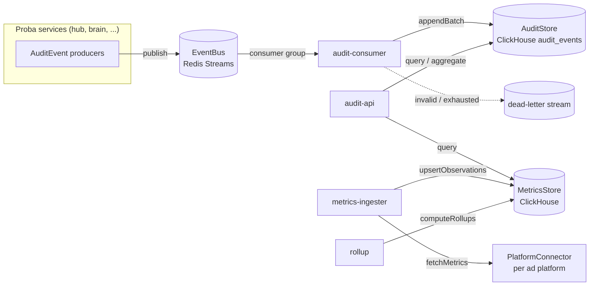

# proba-audit architecture

## Purpose

proba-audit is the audit trail and ad-metrics analytics backend of Proba.

- **Audit:** every Proba service emits an `AuditEvent` for every action or step. proba-audit
  stores them in an append-only, hash-chained log that can be queried by trace, goal, user, time, etc.
- **Metrics:** ad-platform numbers (Meta, Google, Reddit, X, Microsoft, ...) are fetched,
  normalised into `MetricObservation`s, stored with revisions, and rolled up per hour and day.

The event and observation shapes are defined once, in
[proba-protocol](https://github.com/smallseedlabs/proba-protocol) (`@smallseedlabs/proba-protocol/audit`).
This repo never redefines them. (Temporary: pinned to an unmerged PR commit, see `PROTOCOL_PIN_NOTE.md`.)

This PR is the **foundation only**: ports, default adapters, config, logger, migrations and
runnable-but-empty processes. The consumer, API, ingester and rollup logic come later.

## Processes

| App | Port | Job (later) |
|-----|------|-------------|
| `apps/audit-consumer` | 3101 | Read audit events from the bus, validate, extend the hash chain, append to the AuditStore, ack / dead-letter |
| `apps/audit-api` | 3100 | Query API over the AuditStore and MetricsStore |
| `apps/metrics-ingester` | 3102 | Use PlatformConnectors to fetch ad metrics and upsert `MetricObservation`s |
| `apps/rollup` | 3103 | Recompute hourly/daily rollups from the latest observation revisions |

Today each one loads config, logs its lifecycle as structured JSON, serves `GET /health`, and exits 0 on SIGTERM/SIGINT.
All four use `runService` from `packages/core`. One Dockerfile has a target per app (plus `migrate`).

## The two flows



**Audit flow:** producer builds an `AuditEvent` (`buildAuditEvent`) -> `EventBus.publish` -> `audit-consumer`
reads with a consumer group -> validates -> adds `prevHash`/`hash`/`ingestedAt`/`schemaVersion`
(making a `StoredAuditEvent`) -> `AuditStore.appendBatch` (skips duplicate `eventId`s, so redelivery is safe) -> `ack`.
Messages that fail repeatedly are dead-lettered after `BUS_MAX_DELIVERIES` deliveries.

**Metrics flow:** `metrics-ingester` asks a `PlatformConnector` for a window -> `MetricsStore.upsertObservations`
(a higher `revision` replaces a lower one; a stale one is skipped) -> `rollup` calls `computeRollups` for the
touched window -> `audit-api` serves observations and rollups.

## Ports and adapters

Ports are TypeScript interfaces in `packages/core/src/ports`. Adapters live in `packages/adapters`.
The adapter for each port is chosen by an environment variable and created through a registry
(`createDefaultRegistries` / `createRuntime` in `packages/adapters/src/runtime/registries.ts`).

| Port | Default adapter | Other adapters | Config | Contract helper |
|------|-----------------|----------------|--------|-----------------|
| `EventBus` | `RedisStreamsEventBus` (`redis-streams`) | `InMemoryEventBus` (`memory`) | `EVENT_BUS` | `runEventBusContract` |
| `AuditStore` | `ClickHouseAuditStore` (`clickhouse`) | `InMemoryAuditStore` (`memory`) | `AUDIT_STORE` | `runAuditStoreContract` |
| `MetricsStore` | `ClickHouseMetricsStore` (`clickhouse`) | `InMemoryMetricsStore` (`memory`) | `METRICS_STORE` | `runMetricsStoreContract` |
| `Clock` | `SystemClock` | `ManualClock` | code (`createRuntime` option) | `runClockContract` |
| `IdGenerator` | `RandomIdGenerator` | `SequentialIdGenerator` | code (`createRuntime` option) | `runIdGeneratorContract` |
| `Logger` | pino JSON logger (`createLogger`) | `MemoryLogger` | `LOG_LEVEL` | `runLoggerContract` |
| `PlatformConnector` | none yet (one per platform, later) | `StaticPlatformConnector` (tests) | per platform, later | `runPlatformConnectorContract` |

### How to swap or add an adapter (for example Kafka)

1. Implement the port, for example `class KafkaEventBus implements EventBus` in `packages/adapters/src/kafka/`.
2. Run the port's contract suite against it:
   ```ts
   import { runEventBusContract } from '@smallseedlabs/proba-audit-core/testing';
   runEventBusContract('kafka', async () => ({ bus: new KafkaEventBus(...) }));
   ```
   (Put it in an `*.integration.test.ts` file if it needs a running service.)
3. Register one factory: `registries.eventBus.register('kafka', (deps) => new KafkaEventBus(...))`
   in `createDefaultRegistries` (or pass your own `registries` to `createRuntime`).
4. Set one config value: `EVENT_BUS=kafka`.

No config schema change is needed: adapter names are plain strings, checked against the registry at startup
(an unknown name fails with the list of available adapters). No app code changes either, because apps only see ports.

### EventBus delivery model

At-least-once, with consumer groups. `read` delivers new messages, which stay *pending* until `ack`. `reclaimPending`
re-delivers messages idle longer than `BUS_CLAIM_IDLE_MS` (each delivery bumps `deliveryCount`) and dead-letters
those that reached `BUS_MAX_DELIVERIES`. `deadLetter` moves a poison message to the dead-letter store at once.
On Redis Streams: `XADD`, `XREADGROUP`, `XACK`, `XPENDING`+`XCLAIM`, and the `<topic>.dlq` stream.
Redis runs with AOF on in `docker-compose.yml` so the stream survives restarts.

## Data model overview

ClickHouse database `proba_audit` (migrations in `migrations/clickhouse`, applied by `npm run migrate`, tracked in `schema_migrations`):

| Table | Engine | Partition | Order by | Notes |
|-------|--------|-----------|----------|-------|
| `audit_events` | MergeTree | `toYYYYMM(occurred_at)` | `(workspace_id, occurred_at, event_id)` | Raw, append-only. Mirrors `StoredAuditEvent`: ids, actor, category, outcome, cost, `occurred_at`, `details` (JSON text), `tags`, plus `prev_hash`, `hash`, `ingested_at`, `schema_version`. Bloom-filter indexes on `trace_id`, `goal_id`, `thread_id`. |
| `metric_observations` | ReplacingMergeTree(`revision`) | `toYYYYMM(period_start)` | `(platform, account_id, campaign_id, adset_id, ad_id, granularity, period_start)` | Latest revision wins. Read with `FINAL`. `adset_id`/`ad_id` are `''` at campaign level. |
| `metric_rollups_hourly`, `metric_rollups_daily` | ReplacingMergeTree(`computed_at`) | `toYYYYMM(bucket_start)` | `(platform, account_id, campaign_id, adset_id, ad_id, source_granularity, currency, bucket_start)` | Sums per UTC bucket, recomputed from the latest revisions (idempotent). No `reach` (not additive). |
| `schema_migrations` | MergeTree | none | `version` | Applied migrations with checksum. |

Timestamps are UTC (`DateTime64(3, 'UTC')`) and ISO 8601 with a trailing `Z` everywhere on the wire.
Rollup day buckets are UTC days; a per-account timezone day (`MetricObservation.timezone`) is not applied yet.

## The traceId rule

Every audit event has a `traceId` (a UUID). The root is the **web command's `clientMsgId`**, or a **job run id** for background
work (ingester fetch, rollup run). Every step caused by that root reuses the same `traceId` and gets its own
`spanId` (16 lowercase hex characters) with `parentSpanId` pointing at the step that caused it.
Remove the dashes of a `traceId` to get an OpenTelemetry 32-hex trace id.

Logs follow the same rule: when a traceId is known, the JSON log line carries `traceId` (`withTrace(logger, traceId)` or
`logger.child({ traceId })`). Lifecycle logs of a process have no traceId because they belong to no trace.

## Self-logging

Every app logs each lifecycle step as structured JSON (`starting`, `config_loaded`, `listening`, `started`, `stopping`,
`stopped`, plus errors) with a `lifecycle` field. The `Logger` port supports `LogHook`s that receive every emitted record,
so a later `AuditEmitter` can turn these lines into `AuditEvent`s without changing call sites. It is not built yet.

## Configuration

Environment variables, validated with zod at startup (`packages/core/src/config`); see `.env.example` for the full list
with placeholders. Config is logged at startup with passwords and URL credentials redacted.
