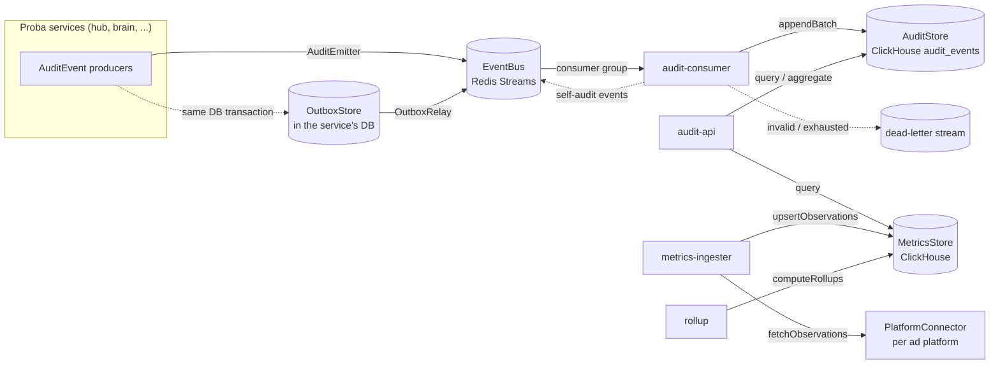

# proba-audit architecture

## Purpose

proba-audit is the audit trail and ad-metrics analytics backend of Proba.

- **Audit:** every Proba service emits an `AuditEvent` for every action or step. proba-audit
  stores them in an append-only, hash-chained log that can be queried by trace, goal, user, time, etc.
- **Metrics:** ad-platform numbers (Meta, Google, Reddit, X, Microsoft, ...) are fetched,
  normalised into `MetricObservation`s, stored with revisions, and rolled up per hour and day.

The event and observation shapes are defined once, in
[proba-protocol](https://github.com/smallseedlabs/proba-protocol) (`@smallseedlabs/proba-protocol/audit`).
This repo never redefines them. (Pinned to the `v0.3.0` release tag.)

This PR is the **foundation only**: ports, default adapters, config, logger, migrations and
runnable-but-empty processes. The consumer, API, ingester and rollup logic come later.

## Processes

| App | Port | Job (later) |
|-----|------|-------------|
| `apps/audit-consumer` | 3101 | Read audit events from the bus, validate, extend the hash chain, append to the AuditStore, ack / dead-letter |
| `apps/audit-api` | 3100 | Query API over the AuditStore and MetricsStore |
| `apps/metrics-ingester` | 3102 | Pull ad metrics through the `PlatformConnector` port on a schedule, validate, store `MetricObservation`s (see "Metrics flow") |
| `apps/rollup` | 3103 | Recompute hourly/daily rollups from the latest observation revisions, per account timezone |

Each one loads config, logs its lifecycle as structured JSON, serves `GET /health`, and exits 0 on SIGTERM/SIGINT
(all four use `runService` from `packages/core`). `audit-consumer` runs the audit pipeline described below,
`metrics-ingester` and `rollup` run the metrics flow ("Metrics flow"); `audit-api` is still the foundation skeleton (its first
read functions exist as a library, see "Read side"). One Dockerfile has a target per app (plus `migrate` and `metrics-report`).

## The two flows



**Audit flow:** a producer records an event with an `AuditEmitter` (directly to the bus, or through the outbox) ->
`audit-consumer` reads with a consumer group -> validates -> dedupes -> derives tags -> adds `prevHash`/`hash`/`ingestedAt`/
`schemaVersion` (making a `StoredAuditEvent`) -> `AuditStore.appendBatch` -> `XACK` only after that write.
Details, guarantees and failure modes are in "Audit pipeline" below.

**Metrics flow:** `metrics-ingester` asks a `PlatformConnector` for what changed since its last cursor ->
validates -> `MetricsStore.upsertObservations` (a higher `revision` replaces a lower one; a stale one is skipped) ->
`rollup` recomputes the touched hourly and daily buckets -> the analytics read functions serve the numbers.
Details: "Metrics flow" below.

## Ports and adapters

Ports are TypeScript interfaces in `packages/core/src/ports`. Adapters live in `packages/adapters`.
The adapter for each port is chosen by an environment variable and created through a registry
(`createDefaultRegistries` / `createRuntime` in `packages/adapters/src/runtime/registries.ts`).

| Port | Default adapter | Other adapters | Config | Contract helper |
|------|-----------------|----------------|--------|-----------------|
| `EventBus` | `RedisStreamsEventBus` (`redis-streams`) | `InMemoryEventBus` (`memory`) | `EVENT_BUS` | `runEventBusContract` |
| `AuditStore` | `ClickHouseAuditStore` (`clickhouse`) | `InMemoryAuditStore` (`memory`) | `AUDIT_STORE` | `runAuditStoreContract` |
| `AuditEmitter` | `createBusAuditEmitter` (publishes to the bus), `createOutboxAuditEmitter` (writes to an outbox) | any `AuditSender` via `createAuditEmitter` | code | unit tests in `audit-pipeline.test.ts` |
| `OutboxStore` | `PostgresOutboxStore` (lives in the emitting service's database) | `InMemoryOutboxStore` | code (the service owns its DB) | `runOutboxStoreContract` |
| `MetricsStore` | `ClickHouseMetricsStore` (`clickhouse`) | `InMemoryMetricsStore` (`memory`) | `METRICS_STORE` | `runMetricsStoreContract` |
| `Clock` | `SystemClock` | `ManualClock` | code (`createRuntime` option) | `runClockContract` |
| `IdGenerator` | `RandomIdGenerator` | `SequentialIdGenerator` | code (`createRuntime` option) | `runIdGeneratorContract` |
| `Logger` | pino JSON logger (`createLogger`) | `MemoryLogger` | `LOG_LEVEL` | `runLoggerContract` |
| `PlatformConnector` | none yet (one per platform, later) | `StaticPlatformConnector` (tests) | per platform, later | `runPlatformConnectorContract` |

### How to swap or add an adapter (for example Kafka)

1. Implement the port, for example `class KafkaEventBus implements EventBus` in `packages/adapters/src/kafka/`.
2. Run the port's contract suite against it:
   ```ts
   import { runEventBusContract } from '@smallseedlabs/proba-audit-core/testing';
   runEventBusContract('kafka', async () => ({ bus: new KafkaEventBus(...) }));
   ```
   (Put it in an `*.integration.test.ts` file if it needs a running service.)
3. Register one factory: `registries.eventBus.register('kafka', (deps) => new KafkaEventBus(...))`
   in `createDefaultRegistries` (or pass your own `registries` to `createRuntime`).
4. Set one config value: `EVENT_BUS=kafka`.

No config schema change is needed: adapter names are plain strings, checked against the registry at startup
(an unknown name fails with the list of available adapters). No app code changes either, because apps only see ports.

### EventBus delivery model

At-least-once, with consumer groups. `read` delivers new messages, which stay *pending* until `ack`. `reclaimPending`
re-delivers messages idle longer than `BUS_CLAIM_IDLE_MS` (each delivery bumps `deliveryCount`) and dead-letters
those that reached `BUS_MAX_DELIVERIES`. `deadLetter` moves a poison message to the dead-letter store at once.
On Redis Streams: `XADD`, `XREADGROUP`, `XACK`, `XPENDING`+`XCLAIM`, and the `<topic>.dlq` stream.
Redis runs with AOF on in `docker-compose.yml` so the stream survives restarts.

## Audit pipeline

### Producing events: `AuditEmitter`, outbox, relay

`AuditEmitter.emit(draft, { tx? })` (`packages/core/src/audit/emitter.ts`) builds the event with the protocol's
`buildAuditEvent` (defaults: `service`, `workspaceId`, `traceId`, `eventId`, `spanId`, `occurredAt`, taken from the emitter,
`IdGenerator` and `Clock`), validates it with the protocol schema (an invalid event throws `AuditValidationError` and is
logged; with `failureMode: 'swallow'` it logs and resolves `null`), then hands it to a transport.
`emitter.forTrace(traceId, parentSpanId)` stamps a trace on everything emitted through it.

Two transports:

- **Bus** (`createBusAuditEmitter`): `EventBus.publish(AUDIT_TOPIC, event, { key: workspaceId })`. Simple, but the event is lost
  if the process dies between the business change and the publish.
- **Outbox** (`createOutboxAuditEmitter` + `OutboxRelay`): the event is inserted into an `audit_outbox` table **in the service's
  own database transaction** (`emit(draft, { tx })`), so it exists if and only if the business change committed. An
  `OutboxRelay` claims rows (`FOR UPDATE SKIP LOCKED` plus a lease, so several relays can run), publishes them to the bus in
  order, then marks them published; a bus failure marks them failed and they are retried after the lease. Publishing is
  at-least-once and the consumer dedupes by `eventId`.

`OutboxStore` is a port. `PostgresOutboxStore` is the adapter meant for the Hub: schema in
`migrations/postgres/0001_audit_outbox.sql` (apply it to the *service's* database, not to ClickHouse), usage:
`await emitter.emit(draft, { tx: pgClientInsideBeginCommit })`. This repo does not change the Hub; wiring it in is a Hub change.

### Consuming events: `apps/audit-consumer`

Per batch (`AuditConsumer.processBatch`):

1. **Validate** every message with the protocol schema. Invalid -> dead-letter with the reason (`invalid audit event: path: message`), error log with the `traceId` if the payload has one. Producer-supplied chain fields are stripped by the schema, never trusted.
2. **Dedupe**, before chaining (a skipped duplicate must never leave a gap in the chain): within the batch and against the store (`AuditStore.findExisting`). Same `eventId` and same content -> skipped silently (counted, acked). Same `eventId` but **different content** -> not written, dead-lettered with a reason naming both content hashes, logged as an error.
3. **Derive tags** (`category:x`, `outcome:x`, `service:x`, `risk:x` when set), appended after the producer's own tags.
4. **Chain** per workspace using the cached head (below).
5. **Write** with `AuditStore.appendBatch`. If it throws, nothing is acknowledged; the batch is retried in place with exponential backoff (`CONSUMER_RETRY_BASE_MS` to `CONSUMER_RETRY_MAX_MS`) and nothing new is read meanwhile, so a store outage does not run messages toward `BUS_MAX_DELIVERIES`.
6. **XACK** only now (duplicates and dead letters are acknowledged too, the latter through `deadLetter`).
7. **Self-audit** (below). It never changes the outcome of the batch.

Shutdown (SIGTERM/SIGINT through `runService`): stop reading, finish the batch in flight (written and acked), close the
subscription, close the adapters. Messages read but not processed stay pending.
Crash recovery: pending messages of a dead consumer are re-delivered by `reclaimPending` (checked every
`CONSUMER_RECLAIM_INTERVAL_MS`, for messages idle longer than `BUS_CLAIM_IDLE_MS`; a restarted consumer therefore picks up
its predecessor's work after at most that idle time). A crash after the write but before the `XACK` is harmless: the
redelivered event is recognised as an identical duplicate. ClickHouse `audit_events` is set to `fsync_after_insert` (migration
0004) so "written" means on disk before the ack.

### Hash chain

- **Scope: one chain per workspace.** The first event of a workspace has `prevHash = null`.
- **Order:** the order the consumer processed events. It is encoded as a strictly increasing `ingestedAt` per workspace (clock time, but at least 1 ms after the previous event of that workspace), so "the head" is always "the greatest `ingestedAt`" and `getChainHead` is unambiguous. Above 1000 events/s in one workspace `ingestedAt` runs ahead of the wall clock.
- **Hash:** `hash = sha256_hex(canonicalizeAuditEvent(storedEvent without hash))`. `canonicalizeAuditEvent` is the protocol's canonical JSON (sorted keys, no whitespace). The hashed object has all stored fields: producer fields, derived tags, `prevHash`, `ingestedAt`, `schemaVersion`. Changing any of them, or removing or reordering events, is detectable.
- **Content hash** (duplicate detection) = sha256 of the same canonical string *without* `prevHash`, `hash`, `ingestedAt`, `schemaVersion`. It is what tells an identical redelivery from a conflicting event with the same `eventId`; it is unaffected by chaining.
- **Storage precision:** before hashing, `occurredAt` is rounded to milliseconds and `cost.amount` to 8 decimals (the ClickHouse column types), so a stored event hashes the same after it is read back.
- **Head cache:** the consumer keeps `{ hash, ingestedAt }` per workspace in memory, filled from `AuditStore.getChainHead` the first time a workspace is seen after a start, and only advanced after a successful write.
- **Verification:** `verifyChain(store, workspaceId, range?, options?)` (`packages/core/src/audit/verify-chain.ts`) pages through `AuditStore.readChain` and checks, per event: protocol schema, workspace, recomputed hash, `prevHash` link, and strictly increasing `ingestedAt`. With no `range.from` the first event must be the genesis; with one it must follow the real predecessor. It returns `{ ok, checked, problems[], lastHash, ... }` with problem types `hash_mismatch`, `broken_link`, `bad_genesis`, `non_monotonic_ingested_at`, `invalid_event`, `workspace_mismatch`. ClickHouse has no index on `ingested_at`, so run it as a maintenance job, not per request.

### Single writer

The cached heads are only correct while **one consumer instance writes** to the store. Run **one `audit-consumer` replica** (scale the
work with bigger batches, not more replicas). The consumer detects one symptom of a second writer (the store accepted fewer events
than it chained), logs `chain integrity risk`, and drops its cached heads; `verifyChain` finds any gap. Making several consumers
safe (partitioning streams by workspace, or a lease per workspace) is a separate design.

### Self-audit

The consumer records its own activity through the same `AuditEmitter` and bus as everyone else (`SELF_AUDIT_ENABLED`, default on):

| Event | When | Notes |
|-------|------|-------|
| `system.audit_batch_processed` | once per workspace written in a batch | `details`: `batchId`, `written`, `duplicatesInBatch`, `deadLettered`; one trace per batch |
| `system.audit_event_dead_lettered` | once per dead letter | `errorCode` `invalid_event` (risk medium) or `conflict` (risk high); a conflict is emitted inside the trace of the offending event |

These events come back through the consumer, so there is a loop guard: a batch consisting only of the consumer's own events (same `service`) produces
no batch event, which stops the feedback after one hop.
`AuditedReader` (`packages/core/src/audit/audited-reader.ts`) is the same idea for reads: audit-api routes call it instead of the store
and each query emits `data_access.audit_query`, `data_access.audit_trace` or `data_access.audit_aggregate` (filter names and result
size, never values or data). audit-api has no query routes yet, so nothing calls it in this repo.

### Logging

Everything is structured JSON through the `Logger` port. Batch lines carry `batchId`; lines about a specific event carry `traceId`
(and `eventId`, `workspaceId`, `messageId`, `deliveryCount`) when known. Errors worth alerting on: `invalid audit event, dead-lettering`,
`conflicting audit event, not written`, `batch failed, nothing acknowledged; retrying`, `chain integrity risk`, `self-audit failed`.

### Failure modes

| Failure | Result |
|---------|--------|
| ClickHouse down | batch retried with backoff, nothing acked, no delivery count growth |
| Redis down | loop backs off and retries; events published meanwhile by services fail at the publisher (use the outbox to keep them) |
| Consumer crash before write | messages stay pending, reclaimed and written once |
| Consumer crash after write, before XACK | reclaimed, recognised as identical duplicates, acked, chain unchanged |
| Same `eventId`, different content | not written, dead-lettered with reason, error log, `system.audit_event_dead_lettered` event |
| Invalid event | dead-lettered with reason |
| Bus failure in the relay | rows marked failed, retried after the lease |

## Metrics flow

```mermaid
flowchart LR
  subgraph Libs["Ad-platform analytics libraries (one per platform, built later)"]
    L1[meta] ~~~ L2[google] ~~~ L3[reddit / x / microsoft]
  end
  STUB[StubPlatformConnector<br/>development data source]
  Libs -. adapter .-> PC
  STUB --> PC[PlatformConnector port]
  PC --> ENG[metrics-ingester<br/>scheduler + SyncEngine]
  ENG -- validated observations --> MS[(metric_observations<br/>ReplacingMergeTree by revision)]
  ENG -- invalid --> Q[(metric_observation_quarantine)]
  ENG <-- cursor --> CP[(ingest_checkpoints)]
  ENG -. metrics.fetch_* / ingested / restated .-> BUS[(audit EventBus)]
  MS -- changedSince --> R[rollup worker]
  R --> RU[(hourly + daily rollups)]
  RU --> RD[MetricsAnalytics<br/>summary, comparePeriods]
  RD --> PORTAL[portals and data tools]
```

The ad platforms are reached through **analytics libraries**, one per platform (Meta, Google, Reddit, X, Microsoft), that expose
each platform's analytics data and are consumed by the portals. Those libraries do not exist yet. The ingester is built against the
`PlatformConnector` port, today served by a **development data source**, so the whole flow runs and is tested now, and the real
library plugs in later by configuration only.

### `PlatformConnector` (packages/core/src/ports/platform-connector.ts)

| Member | Meaning |
|--------|---------|
| `platform` | Stable id from the protocol enum (`meta`, `google`, `reddit`, `x`, `microsoft`, `other`) |
| `adapter` | Name used in `PLATFORM_CONNECTORS` (for example `stub`) |
| `capabilities()` | Granularities (`hour`, `day`), `maxLookbackDays`, `supportsRestatements`, `restatementWindowHours`, `supportsCursor`, `maxPageSize` |
| `listAccounts(workspaceId)` / `listCampaigns(account)` | What the workspace has connected; accounts carry the IANA reporting `timezone` and `currency` |
| `fetchObservations(account, { window, cursor?, pageToken?, pageSize? })` | One page of protocol `MetricObservation`s plus `nextPageToken` (more pages) and `nextCursor` (store it once the whole pull is durable) |

Rules every adapter follows (`runPlatformConnectorContract(name, factory, fixture)` checks them): valid observations of the connector's
platform and the requested account/granularity; `revision` starts at 0 and grows by one per restatement; **one level per campaign**
(ad rows, or adset rows, or campaign rows, never a mix, because rollups sum rows per campaign); no credentials in an observation;
failures thrown as `RateLimitedError` (with the platform's `retryAfterMs` hint), `TransientConnectorError`, `ConnectorAuthError`
or `ConnectorRequestError`. The cursor is opaque: with it the connector returns only new and restated observations; without it, the full window.

### The stub (`StubPlatformConnector`, adapter name `stub`)

A development data source, not a mock of a real service: deterministic from `STUB_SEED` and the clock (the same seed, account, ad
and hour always give the same numbers), with a diurnal curve in each account's local time. Per platform it serves three accounts
(Europe/London GBP, America/New_York USD, Australia/Sydney AUD) with several campaigns, adsets and ads, hourly and daily rows of
impressions, clicks, spend, conversions, reach, video views and revenue.

- **Restatements:** the revision of a completed period is a pure function of time: every `STUB_RESTATE_EVERY_MINUTES` after the period
  ends the platform revises it again (late conversions mostly go up, spend moves slightly), up to `STUB_RESTATE_REVISIONS` times.
  Set revisions to 0 for a platform that never restates. A daily row is the sum of its hourly rows at the same moment.
- **Faults:** `STUB_FAILURE_RATE` fails a fraction of calls with a transient error; tests use `injectFault(...)` (rate limit with
  hint, transient, auth, request) and `corruptNext(...)` (invalid observations for the quarantine).
- **Every `sourceRef` starts with `stub:`**, so development data can never be mistaken for platform data.
- **Production guard:** the stub refuses to start when `NODE_ENV=production` unless `ALLOW_STUB_CONNECTOR=true`
  (`StubConnectorNotAllowedError`, thrown while the ingester starts, so the process exits).

### Ingest engine (`apps/metrics-ingester`)

`IngestScheduler` runs one loop per (platform, account) of every configured connector: first run after a small random delay, then
every `INGEST_INTERVAL_MS` (60 s by default; `INGEST_INTERVAL_OVERRIDES=meta:30000,google:120000` per platform) with
`INGEST_JITTER_RATIO` jitter. After failures the delay doubles up to `INGEST_FAILURE_BACKOFF_MAX_MS`, and never goes below a platform's
rate-limit hint. Accounts are re-listed every `INGEST_ACCOUNT_REFRESH_MS`.

**Overlap protection and the single-instance assumption.** A lease per (platform, account) prevents two runs of one account at the same
time; a lease expires after a few intervals so a hung run cannot block the account. The lease lives in the process: **run one
`metrics-ingester` replica** (and one `rollup`). A second replica would not corrupt anything (runs are idempotent and revision-ordered)
but would pull every window twice and waste platform quota. Scaling out later needs a shared lease (Redis) behind the same `LeaseTable` shape.

`SyncEngine.syncAccount` is one run, with its own `traceId` (also on every log line):

1. Read the checkpoint for (workspace, platform, account, granularity). Window: from the last success minus the connector's
   restatement window (or `INGEST_INITIAL_LOOKBACK_HOURS` on a first run), clamped to `maxLookbackDays`, to the last full hour.
   After downtime the window reaches back to the last success, so nothing is missed.
2. Fetch pages (`INGEST_PAGE_SIZE`) with the stored cursor. Each call is retried up to `INGEST_MAX_ATTEMPTS` with exponential backoff and
   full jitter (`INGEST_RETRY_BASE_MS` .. `INGEST_RETRY_MAX_MS`). A rate-limit hint is honoured; one longer than
   `INGEST_MAX_RATE_LIMIT_WAIT_MS` ends the run and the scheduler comes back after it. Auth and request errors are not retried.
3. Validate every observation with the protocol's `validateMetricObservation`, and check platform and account. Invalid ones go to
   `metric_observation_quarantine` with a reason (`schema_invalid`, `platform_mismatch`, `account_mismatch`), the validation issues
   (paths and messages) and the raw payload; the rest of the page continues.
4. Compare the page with what is stored and write only what changes: new periods, higher revisions, corrected values.
   Pulling the same window twice therefore writes nothing (`unchanged`), a stale revision is ignored (`staleSkipped`).
5. Only after the last page is durable, store the new cursor. A crash anywhere means the next run repeats the window, harmlessly.

Audit events (through the `AuditEmitter` on the bus, category `metrics`, target `ad_account` `platform:accountId`, actor the service): `metrics.fetch_started`,
`metrics.ingested` (count, window; only when something new was stored), `metrics.restated` (count, earliest/latest period; only when
something was restated), `metrics.fetch_completed` (counts, pages, window, `durationMs`) or `metrics.fetch_failed` (outcome `failure`,
`errorCode`, redacted message, attempts, `retryAfterMs`). One `ingested` / `restated` event per run, not per observation (a run
can hold thousands). No credentials, tokens or `credentialsRef` ever appear in logs or events.
Volume to expect: two events per account per interval (start and completion), so 60 s intervals mean about 2,900 events per account per day.

### Rollups (`apps/rollup`)

`RollupWorker` asks `MetricsStore.changedSince(watermark)` which span of observations was written (or rewritten by a restatement)
since the stored watermark, and recomputes the hourly and daily buckets that span touches, **from the latest revision of every
observation**: a restatement replaces its earlier revision in the sums, it is never added to it, and recomputing the same window gives the same rows.
Hourly buckets are UTC hours. **Daily buckets are local days in each observation's `timezone`** (UTC when it has none): `bucket_start`
is the UTC instant of local midnight, `timezone` and `bucket_date` (the local calendar date) are stored, and a daily bucket is always
summed whole (a 23- or 25-hour DST day included). `reach` is never summed (unique reach is not additive). Windows larger than
`ROLLUP_MAX_WINDOW_DAYS` are split. The watermark (in `ingest_checkpoints`, source `rollup`) moves only after a run succeeds; each run emits `metrics.rollup_run`
(period, rows, `durationMs`, own `traceId`). ClickHouse needs constant time zones, so daily rollups run once per zone present (zone names are validated before use).

### Read side (library level)

`MetricsAnalytics` (packages/core/src/analytics) is the first set of read functions over the rollups. They will back the portal and the
controlled data tools; the brain never queries metric tables itself.

- `getMetricsSummary(scope, { campaignId?, from, to, granularity })`: totals per currency (with CTR, CPC, CPM, CPA, ROAS), a series per bucket
  (hourly: UTC hours; daily: local dates) and campaigns by spend. Currencies are never added together; `reach` is never returned as a sum.
- `comparePeriods(scope, { campaignId?, granularity, current, previous? })`: two equal-length periods and the change (absolute and percent) per currency;
  `previous` defaults to the period right before `current`.
- **Scope is injected, not passed by the caller.** `AnalyticsScope { workspaceId, accounts[] }` is produced by trusted code. `AuditedAnalyticsReader`
  (the metrics counterpart of `AuditedReader`) takes a `ScopeResolver` and a caller's `AccessContext`, resolves the scope itself, refuses a scope of another
  workspace, and records every read as `data_access.metrics_summary` / `data_access.metrics_compare` (filter names and result size only, never numbers; failures too).
- **Strict validation with caps:** unknown keys are rejected (so a query cannot smuggle in accounts), timestamps must be UTC ISO with `Z` and aligned
  to the bucket (hour: on the hour; day: UTC midnight, the date of the daily bucket), at most 14 days hourly and 366 days daily, campaign ids
  `[A-Za-z0-9_.:-]{1,128}`, at most 500 accounts in a scope, at most 200 campaign rows (`ANALYTICS_LIMITS`).
- `sourceGranularity` (default `hour`, must match `INGEST_GRANULARITY`) keeps hourly and daily source rows from being mixed.

Known limit: the metric tables have no `workspace_id` column today; isolation between workspaces is the account scope. One deployment
serves one workspace's connectors (`INGEST_WORKSPACE_ID`) until the tables get a workspace column.

### How to swap the stub for a real analytics library

1. Implement `PlatformConnector` in an adapter that wraps the library (for example `packages/adapters/src/meta-lib/meta-lib-platform-connector.ts`). Map its
   data to protocol `MetricObservation`s (revision from 0, the account's IANA timezone, `sourceRef` an opaque pointer that does **not** start with `stub:`),
   and map its errors to the typed `ConnectorError`s (rate limits with the platform's `retryAfterMs`). Keep credentials inside the library.
2. Prove it with the contract: `runPlatformConnectorContract('MetaLibConnector', () => new MetaLibConnector(...), { now, advance? })` in the adapter's test file.
3. Register it, one line in `createDefaultRegistries()`:
   `platformConnector.register('meta-lib', ({ config, clock, platform }) => new MetaLibConnector({ platform, ... }))`.
4. Set `PLATFORM_CONNECTORS=meta:meta-lib,google:stub` (any mix per platform). Nothing else changes: the scheduler, retries, checkpoints, quarantine, rollups,
   audit events and read functions are the same. Existing development data stays in the tables under `stub:` source refs; clear it (or use a fresh database)
   before pointing a platform at real data.

### Configuration

| Variable | Default | Meaning |
|----------|---------|---------|
| `PLATFORM_CONNECTORS` | empty | `platform:adapter` pairs, for example `meta:stub,google:stub`; empty means the ingester idles |
| `ALLOW_STUB_CONNECTOR` | `false` | Allow the stub when `NODE_ENV=production` |
| `CHECKPOINT_STORE`, `QUARANTINE_STORE` | `clickhouse` | `clickhouse` or `memory` (adapter registry keys) |
| `INGEST_WORKSPACE_ID` | `seedbed` | Workspace the ingester and rollup act for |
| `INGEST_INTERVAL_MS` / `INGEST_INTERVAL_OVERRIDES` | `60000` / empty | Interval per account; per platform overrides `meta:30000,...` |
| `INGEST_JITTER_RATIO`, `INGEST_GRANULARITY` | `0.1`, `hour` | Spread of each delay; `hour` or `day` |
| `INGEST_INITIAL_LOOKBACK_HOURS`, `INGEST_PAGE_SIZE`, `INGEST_ACCOUNT_REFRESH_MS` | `48`, `500`, `300000` | First-run backfill, page size, account re-listing |
| `INGEST_MAX_ATTEMPTS`, `INGEST_RETRY_BASE_MS`, `INGEST_RETRY_MAX_MS`, `INGEST_MAX_RATE_LIMIT_WAIT_MS`, `INGEST_FAILURE_BACKOFF_MAX_MS` | `4`, `1000`, `30000`, `60000`, `600000` | Retry and backoff |
| `STUB_SEED`, `STUB_RESTATE_EVERY_MINUTES`, `STUB_RESTATE_REVISIONS`, `STUB_FAILURE_RATE` | `proba-dev`, `30`, `2`, `0` | The development data source |
| `ROLLUP_INTERVAL_MS`, `ROLLUP_MAX_WINDOW_DAYS` | `30000`, `7` | Rollup cadence and chunk size |

### End to end on the stub

```bash
docker compose --profile metrics-e2e up -d --build e2e-ingester e2e-rollup e2e-audit-consumer
docker compose --profile metrics-e2e run --rm metrics-report     # waits up to 90 s, prints the read-side output as JSON
docker compose --profile metrics-e2e down
```

The profile sets `NODE_ENV=development` and `ALLOW_STUB_CONNECTOR=true` for its own services only; the `apps` profile stays production-like and refuses the stub.

### Failure modes (metrics)

| Failure | What happens |
|---------|--------------|
| Platform rate limit | Wait for the hint (up to `INGEST_MAX_RATE_LIMIT_WAIT_MS`), else end the run and come back after it |
| Transient platform error | Retried with backoff; after `INGEST_MAX_ATTEMPTS` the run fails (`metrics.fetch_failed`), cursor unchanged, scheduler backs off |
| Credentials rejected / bad request | Run fails at once, no retry, audited |
| Invalid observation | Quarantined with reason, rest of the page stored |
| Store (ClickHouse) down | Retried with backoff, then the run fails; cursor unchanged |
| Crash mid-run | No cursor was written; the next run repeats the window and double counts nothing |
| Rollup failure | Watermark unchanged; the next run recomputes the same window |
| Consumer's stream or group deleted | The audit-consumer recreates the stream and group and carries on |

## Data model overview

ClickHouse database `proba_audit` (migrations in `migrations/clickhouse`, applied by `npm run migrate`, tracked in `schema_migrations`):

| Table | Engine | Partition | Order by | Notes |
|-------|--------|-----------|----------|-------|
| `audit_events` | MergeTree | `toYYYYMM(occurred_at)` | `(workspace_id, occurred_at, event_id)` | Raw, append-only. Mirrors `StoredAuditEvent`: ids, actor, category, outcome, cost, `occurred_at`, `details` (JSON text), `tags`, plus `prev_hash`, `hash`, `ingested_at`, `schema_version`. Bloom-filter indexes on `trace_id`, `goal_id`, `thread_id`. |
| `metric_observations` | ReplacingMergeTree(`revision`) | `toYYYYMM(period_start)` | `(platform, account_id, campaign_id, adset_id, ad_id, granularity, period_start)` | Latest revision wins. Read with `FINAL`. `adset_id`/`ad_id` are `''` at campaign level. |
| `metric_rollups_hourly`, `metric_rollups_daily` | ReplacingMergeTree(`computed_at`) | `toYYYYMM(bucket_start)` | `(platform, account_id, campaign_id, adset_id, ad_id, source_granularity, currency, bucket_start)` | Sums per bucket, recomputed from the latest revisions (idempotent). Hourly buckets are UTC hours; daily buckets are local days of the account (`timezone`, `bucket_date`, migration `0006`). No `reach` (not additive). |
| `ingest_checkpoints` | ReplacingMergeTree(`updated_at`) | none | `(workspace_id, source, account_id, stream)` | Last successful cursor per (workspace, platform, account, granularity); the rollup watermark uses source `rollup`. Migration `0005`. |
| `metric_observation_quarantine` | MergeTree | `toYYYYMM(quarantined_at)` | `(workspace_id, platform, account_id, quarantined_at, quarantine_id)` | Dead letter for invalid observations: reason, issues, raw payload, run id. 90 day TTL. Migration `0005`. |
| `schema_migrations` | MergeTree | none | `version` | Applied migrations with checksum. |

`audit_events` also has `fsync_after_insert = 1, fsync_part_directory = 1` (migration `0004`). The Postgres outbox table is separate: `migrations/postgres/0001_audit_outbox.sql`.

Timestamps are UTC (`DateTime64(3, 'UTC')`) and ISO 8601 with a trailing `Z` everywhere on the wire.
Rollup day buckets follow the account's reporting timezone (`MetricObservation.timezone`, UTC when absent); see "Rollups".

## The traceId rule

Every audit event has a `traceId` (a UUID). The root is the **web command's `clientMsgId`**, or a **job run id** for background
work (ingester fetch, rollup run). Every step caused by that root reuses the same `traceId` and gets its own
`spanId` (16 lowercase hex characters) with `parentSpanId` pointing at the step that caused it.
Remove the dashes of a `traceId` to get an OpenTelemetry 32-hex trace id.

Logs follow the same rule: when a traceId is known, the JSON log line carries `traceId` (`withTrace(logger, traceId)` or
`logger.child({ traceId })`). Lifecycle logs of a process have no traceId because they belong to no trace.

## Self-logging

Every app logs each lifecycle step as structured JSON (`starting`, `config_loaded`, `listening`, `started`, `stopping`,
`stopped`, plus errors) with a `lifecycle` field. The `Logger` port supports `LogHook`s that receive every emitted record,
so lifecycle logs can later be turned into `AuditEvent`s without changing call sites. Today audit events are emitted
explicitly through the `AuditEmitter`; no log hook is registered.

## Configuration

Environment variables, validated with zod at startup (`packages/core/src/config`); see `.env.example` for the full list
with placeholders. Config is logged at startup with passwords and URL credentials redacted.
